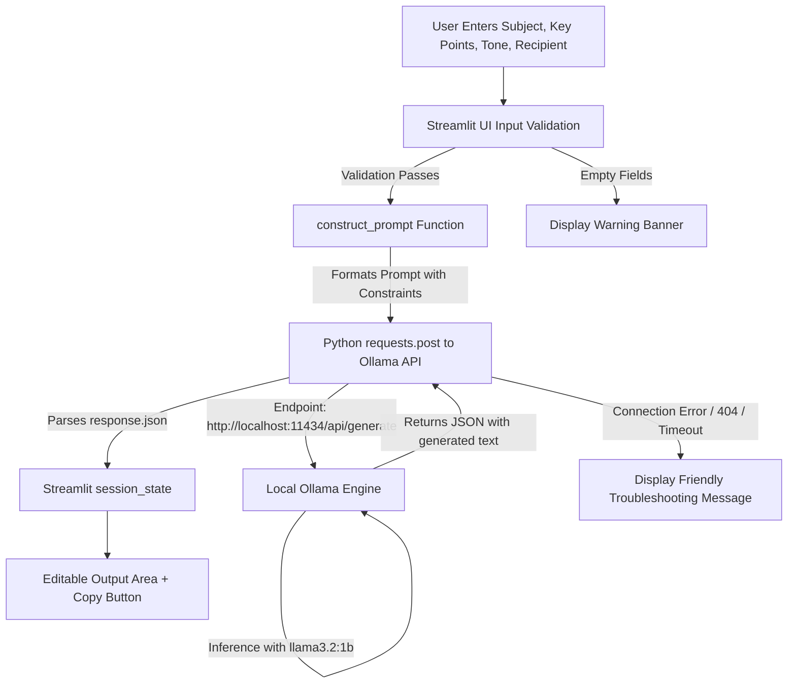

# AI Email Drafting Assistant (Local LLM via Ollama)

A complete, beginner-friendly web application built with **Streamlit**, **Python Requests**, and **Ollama**, powered by the lightweight open-source **Llama 3.2 (1B)** model. 

Draft professional, structured, and natural emails locally on your machine with **zero cloud dependencies, zero API fees, and complete data privacy**.

---

## 📌 Table of Contents
1. [Overview & Problem Statement](#overview--problem-statement)
2. [Technology Stack](#technology-stack)
3. [Key Features](#key-features)
4. [Architecture & Workflow](#architecture--workflow)
5. [Prerequisites & Installation](#prerequisites--installation)
   - [Step 1: Install & Set Up Ollama](#step-1-install--set-up-ollama)
   - [Step 2: Pull the Llama 3.2 (1B) Model](#step-2-pull-the-llama-32-1b-model)
   - [Step 3: Install Python Dependencies](#step-3-install-python-dependencies)
6. [Running the Application](#running-the-application)
7. [Step-by-Step Usage & Test Case](#step-by-step-usage--test-case)
8. [Error Handling & Edge Cases](#error-handling--edge-cases)
9. [Viva & Technical Discussion Preparation](#viva--technical-discussion-preparation)

---

## 1. Overview & Problem Statement

Drafting emails for formal, professional, or casual settings is a frequent productivity hurdle. Most AI assistants (like ChatGPT, Claude, or Gemini) rely on external cloud servers, which present issues such as:
- Data privacy concerns (confidential email notes sent to third-party cloud servers).
- Ongoing API costs and rate limits.
- Internet dependency.

**Solution:**
This application runs a local Large Language Model (**Llama 3.2: 1B**) directly on the user's computer using **Ollama**. Users enter their subject, recipient name, tone, and bullet key points. The application structures an effective prompt, communicates with Ollama's local HTTP API, and renders an editable email draft in a clean Streamlit interface.

---

## 2. Technology Stack

| Component | Technology | Role / Purpose |
| :--- | :--- | :--- |
| **Programming Language** | Python 3.10+ | Core application logic |
| **Frontend Framework** | Streamlit | Reactive, interactive web user interface |
| **Local AI Engine** | Ollama | Local LLM inference server running on port `11434` |
| **Language Model** | Llama 3.2 (1B) | Lightweight, efficient open-source instruction-tuned LLM |
| **HTTP Client** | Python `requests` | Sends synchronous JSON POST requests to Ollama API |
| **Clipboard Utility** | `pyperclip` | One-click copy of generated email |

---

## 3. Key Features

- **Clean & Responsive UI**: Split-column layout with inputs on the left and generated email on the right.
- **Tone Customization**: Support for 4 tones:
  - *Professional* (standard corporate communication)
  - *Formal* (academic, administrative, or official requests)
  - *Friendly* (colleagues, team members, acquaintances)
  - *Polite* (requests, inquiries, soft negotiations)
- **Recipient Customization**: Optional recipient field for personalized greetings.
- **Editable Drafts**: Generated emails appear in an interactive text area for instant manual adjustments.
- **One-Click Copying**: Dual copy options (clipboard button + Streamlit code box copy).
- **Reset / Clear Button**: Clears all session state variables cleanly with one click.
- **Live Ollama Health Monitor**: Sidebar indicator verifies whether Ollama is running and whether `llama3.2:1b` is installed.
- **Word & Character Metrics**: Live count of words and characters in the draft.

---

## 4. Architecture & Workflow



### Communication Flow:
1. **User Interaction**: User inputs data into Streamlit widgets.
2. **Input Validation**: Ensures mandatory fields (Subject, Key Points) are not blank.
3. **Prompt Engineering**: Wraps user inputs with structural instructions, tone enforcement, and hallucination guardrails.
4. **Local HTTP POST**: `requests.post("http://localhost:11434/api/generate", json={model: "llama3.2:1b", prompt: ..., stream: False})`.
5. **Local Inference**: Ollama loads weights into RAM/VRAM and computes token generation.
6. **Rendering**: Streamlit receives response JSON, updates session state, and displays the editable draft.

---

## 5. Prerequisites & Installation

### Step 1: Install & Set Up Ollama
1. Download Ollama for your operating system from the official website: [https://ollama.com/download](https://ollama.com/download).
2. Install the application.
3. Verify Ollama is running in your terminal:
   ```bash
   ollama --version
   ```
4. If Ollama service is not running in background, start it:
   ```bash
   ollama serve
   ```

### Step 2: Pull the Llama 3.2 (1B) Model
Download the lightweight 1-billion parameter model (~1.3 GB):
```bash
ollama pull llama3.2:1b
```
To test the model in terminal:
```bash
ollama run llama3.2:1b "Write a 2-line greeting"
```

### Step 3: Install Python Dependencies
Open your command prompt or terminal in the project directory:
```bash
cd AI_Email_Assistant
pip install -r requirements.txt
```

---

## 6. Running the Application

Launch the Streamlit web application:
```bash
streamlit run app.py
```

Streamlit will automatically open the application in your default web browser at:
```
http://localhost:8501
```

---

## 7. Step-by-Step Usage & Test Case

### Sample Test Input:
- **Email Subject**: `Request for Leave`
- **Recipient Name (Optional)**: `Professor Sharma`
- **Email Tone**: `Formal`
- **Key Points**:
  ```text
  - I am unable to attend college tomorrow.
  - I have some personal work.
  - Request permission for one day of leave.
  - I will ensure to catch up on any missed lectures and assignments.
  ```

### Expected Output:
```text
Subject: Request for Leave

Dear Professor Sharma,

I am writing to formally request permission for one day of leave tomorrow, as I have some personal work that requires my immediate attention. Consequently, I will be unable to attend college for the day.

I assure you that I will coordinate with my classmates to catch up on all lectures and complete any assignments given during my absence. 

Thank you for your understanding and consideration.

Sincerely,
[Your Name]
```

---

## 8. Error Handling & Edge Cases

The application handles edge cases gracefully without crashing:
1. **Ollama Server Offline**:
   - *Symptom*: `requests.exceptions.ConnectionError`.
   - *Message*: Informs the user that Ollama is unreachable at `http://localhost:11434` and prompts them to run `ollama serve`.
2. **Model Not Found (HTTP 404)**:
   - *Symptom*: Model `llama3.2:1b` has not been pulled yet.
   - *Message*: Displays the exact command to pull the model (`ollama pull llama3.2:1b`).
3. **Empty Input Fields**:
   - *Symptom*: User leaves Subject or Key Points blank and clicks Generate.
   - *Message*: Informative warning banners prompting for required information before sending an API call.
4. **Timeout**:
   - *Symptom*: Generation exceeds 60 seconds due to heavy system load.
   - *Message*: Alerts user of timeout and invites a retry.
5. **Empty or Unexpected Response**:
   - *Symptom*: Model output is empty.
   - *Message*: Prompts the user to refine inputs or try again.

---

## 9. Viva & Technical Discussion Preparation

### Q1: Why use Ollama instead of cloud AI APIs (like OpenAI or Gemini)?
- **Privacy**: All text stays strictly on your local machine; sensitive corporate or personal data is never transmitted across the network.
- **Cost**: Open-source models (like Llama 3.2) run free of charge without token-based API billing.
- **Offline Reliability**: Works completely offline without internet connectivity.

### Q2: What is the purpose of setting `"stream": false` in Ollama's API call?
- By default, LLMs stream tokens as they are generated (`chunk by chunk`).
- Setting `"stream": false` instructs Ollama to complete the entire generation process and return a single JSON object containing the complete response. This simplifies backend logic for single-turn drafting.

### Q3: How is the prompt engineered to prevent hallucination?
- We explicitly instruct the model: *"Do NOT invent facts, dates, names, or promises not mentioned in the key points."*
- We specify structural boundaries: *"Output ONLY the email (Subject, Salutation, Body, and Closing). Do NOT include preamble or conversational filler."*
- We use a lower temperature setting (`temperature: 0.4`), which reduces randomness and promotes consistent, fact-focused responses.

### Q4: How does Streamlit handle state across reruns?
- Streamlit reruns the script from top to bottom whenever an interactive widget changes.
- To prevent user inputs and generated emails from disappearing during reruns, we store them in `st.session_state`.
- The **Clear** button resets these keys and updates the UI instantly.

